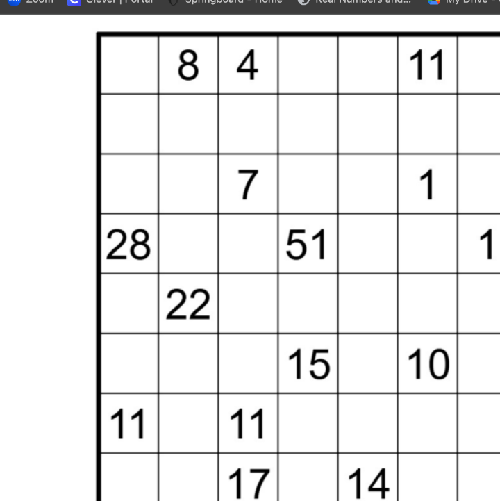
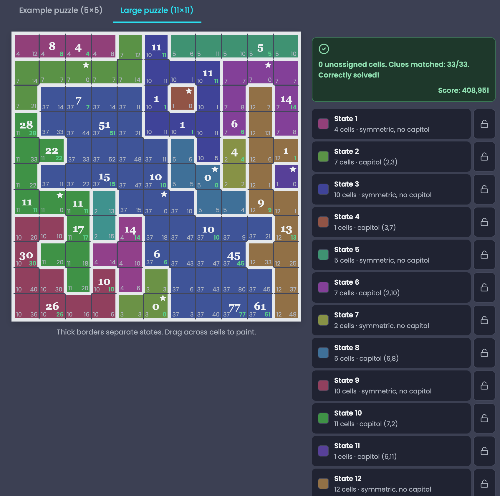

# It's a Metric, Too.

### Eight days of symmetry, shortest paths, and a lot of trial and error.

*A dive into my thought process and tools that helped me solve this puzzle*

[The original puzzle](https://www.janestreet.com/puzzles/) · [Interactive puzzle board](https://pazqo.github.io/#/games/nation-puzzle) · [My notes](#my-handwritten-notes)

<!-- OPTIONAL HEADER: Upload a wide image to assets/banner.png, then remove the comment markers around the next line. -->
!--  -->

---

## The puzzle

I spent eight days working on **“It's a Metric, Too”**, a Jane Street puzzle involving an 11 × 11 grid, symmetric regions, and shortest-path distances. What started as a pencil-and-paper challenge gradually became an exploration of how geometry and graph theory interact.

<!-- TODO: Upload an image of the *unsolved* puzzle as assets/original-puzzle.png and uncomment below. -->
!--  -->

### The rules, in brief

The grid must be partitioned into **states**:

1. Every square belongs to exactly one state, and each state is connected through horizontal or vertical neighbors.
2. Every state has at least one **nontrivial symmetry** (a reflection or rotation).
3. Some states have a **capital**: a square fixed by every symmetry of that state. States whose symmetries have no common fixed square have no capital.
4. Traveling between orthogonally adjacent squares **within the same state** costs the size of that state.
5. Crossing between **different states** costs the size of the smaller state.
6. A numbered square specifies the **minimum total travel cost** from that square to any capital.

Once every clue is satisfied, the puzzle asks for the sum of the **squares of the row totals**, where each square contributes the size of its state.

> **Source:** Jane Street's *It's a Metric, Too*. This page is a personal account of my work, not an official puzzle solution or affiliated project.

---

## How I approached it

I began by working directly with the numbered grid and looking for relationships between nearby clues. I tried to reason about possible state sizes, where capitals could exist, and which shapes could satisfy the symmetry requirements.

One of the most interesting aspects was that a configuration could look locally convincing but fail when checked against distances elsewhere on the board. I kept revisiting assumptions, redrawing regions, and testing alternatives.

<!-- TODO: Replace this paragraph with a more specific memory from your first few days. -->

### The mathematical ideas I explored

| Idea | Why it mattered |
| :--- | :--- |
| **Symmetry** | Restricted which shapes could form states and where capitals could lie. |
| **Connected regions** | Prevented states from being collections of disconnected squares. |
| **Weighted shortest paths** | Made every boundary and state size affect clues elsewhere in the grid. |
| **Constraint propagation** | Helped rule out some configurations before fully drawing them. |
| **Computational search** | Showed how quickly the number of possible configurations can grow. |

A useful observation was that, for adjacent squares \(u\) and \(v\), the difference between their distances to the nearest capital cannot exceed the cost of the edge connecting them:

$$
|d(u)-d(v)| \leq w(u,v).
$$

This was one way to turn the clues into restrictions on possible state sizes.

---

## My handwritten notes

These pages are part of the actual process — including guesses that didn't work. I wanted to preserve the reasoning rather than present only a cleaned-up final solution.

<!-- HOW TO ADD YOUR NOTES:
1. Upload selected PNG/JPG exports from your iPad to assets/.
2. Replace the placeholder filenames below with the actual names.
3. Add a few sentences under each image explaining what you were investigating.
4. Delete any sections you don't need.
-->

### 01 · Early observations

*What I was testing:* [Add your first deductions, initial diagrams, and why you thought they might work.]

!--  -->

### 02 · Working with symmetry and state sizes

*What changed:* [Explain one important constraint or realization you discovered.]

!--  -->

### 03 · The difficult regions

*Where I got stuck:* [Describe your attempts around the larger numbered clues and any configurations you revised.]

!--  -->

<strong>More notebook pages</strong> (expand)

Add additional pages here, with a short caption for each one. This keeps the main page readable while letting interested readers explore the full process.

!--  -->

---

## When I started experimenting digitally

Eventually I used an interactive board at **[pazqo.github.io — Nation Puzzle](https://pazqo.github.io/#/games/nation-puzzle)**. Being able to change state boundaries, see state sizes, and check the clue distances made experimentation much easier than redrawing the entire board by hand.

The tool didn't replace the mathematical reasoning, but it made testing ideas and spotting contradictions significantly more practical.

<!-- TODO: Add the creator's name and LinkedIn attribution here once you've confirmed the original source. -->
<!--  -->

### What the interactive board changed

[Add a concrete example: a region you modified, a clue that stopped matching, or an assumption you abandoned after seeing the feedback.]

---

## The completed puzzle

After seeing the verified completed arrangement, the feature that stood out most was an irregular **37-square state**. It helped explain why several of the largest clues were so difficult to reconcile with smaller, local guesses.

<!-- OPTIONAL SPOILER: Upload a screenshot of the final verified board and uncomment the image. -->

<strong>Show the completed board (spoiler)</strong>

!--  -->

**Final score: 408,951.**

---

## What I took away from eight days

[Write this in your own voice. A good starting point: What surprised you? Which assumption cost you the most time? What did you learn about the difference between a correct mathematical model and an efficient search strategy?]

I wanted this repository to show the process, not just the answer. The incorrect paths, revisions, and handwritten pages are as much a part of the project as the final grid.

---

## Links and credits

- **Original challenge:** [Jane Street Puzzles](https://www.janestreet.com/puzzles/) — *It's a Metric, Too*.
- **Interactive exploration:** [Nation Puzzle](https://pazqo.github.io/#/games/nation-puzzle). Credit to the tool's creator; add the creator's confirmed name/link here.
- **Notes and commentary:** My own exploration, documented over eight days.

<!-- Editorial checklist before publishing:
[ ] Replace or delete all bracketed TODO text.
[ ] Upload your selected notes and uncomment their Markdown image lines.
[ ] Add confirmed credit for the interactive tool creator.
[ ] Add an original puzzle screenshot if reuse is permitted, or link instead.
[ ] Decide whether you want the final board revealed behind the spoiler.
[ ] Remove any unused sections.
-->
