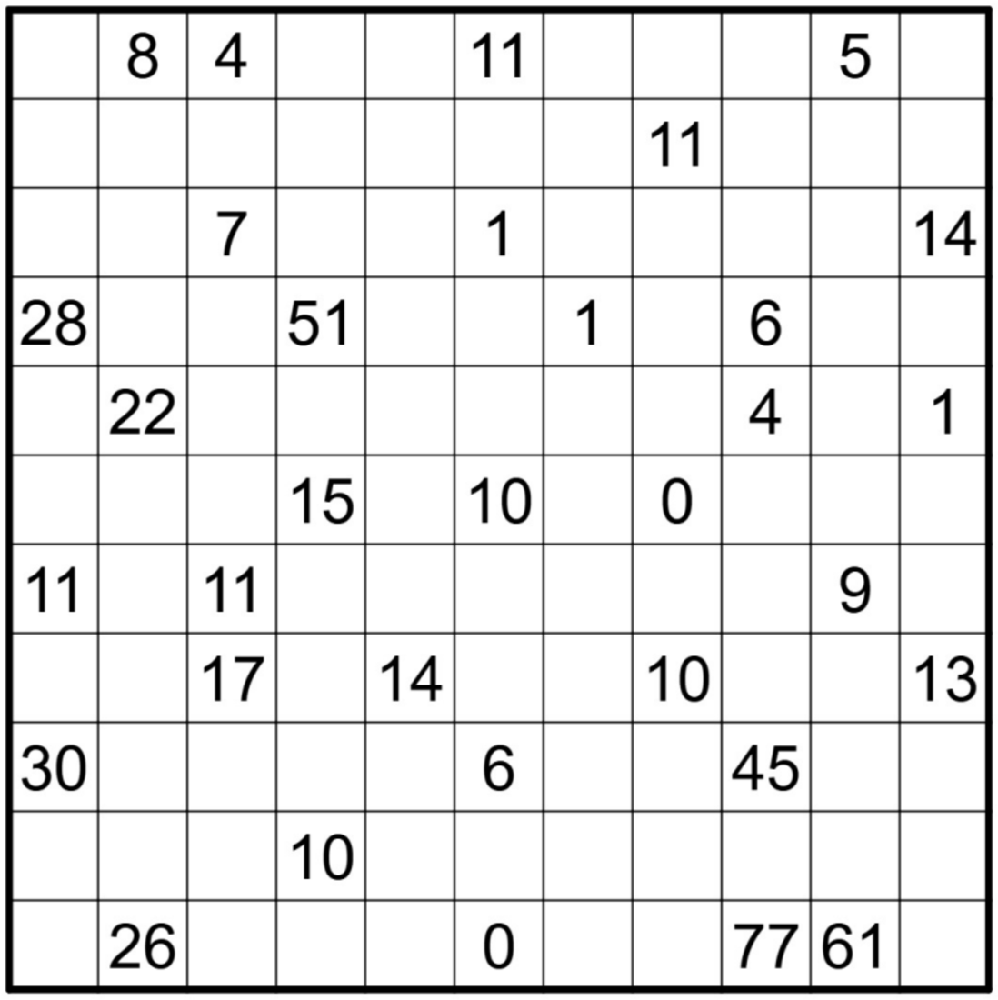
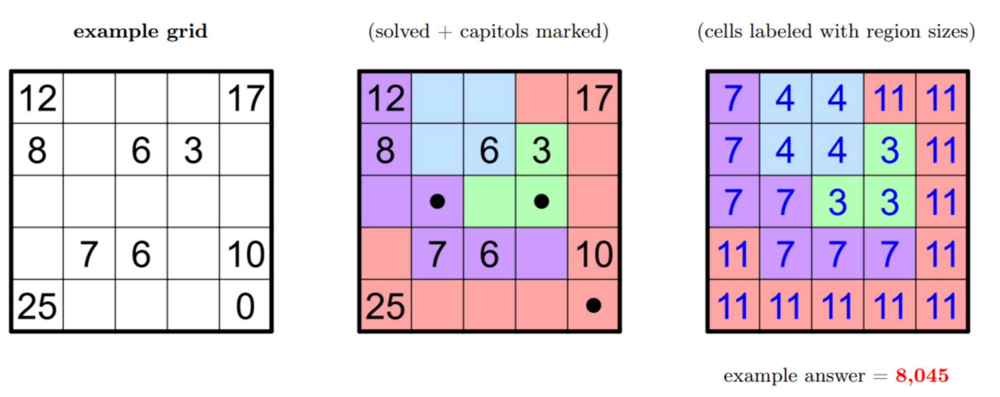
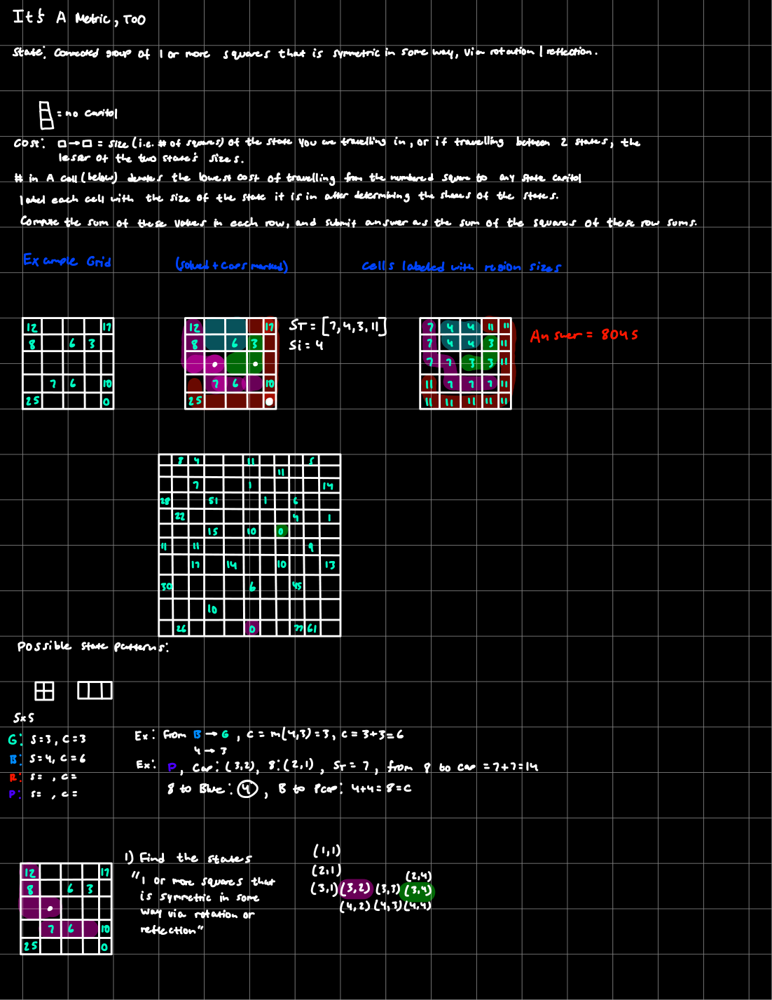
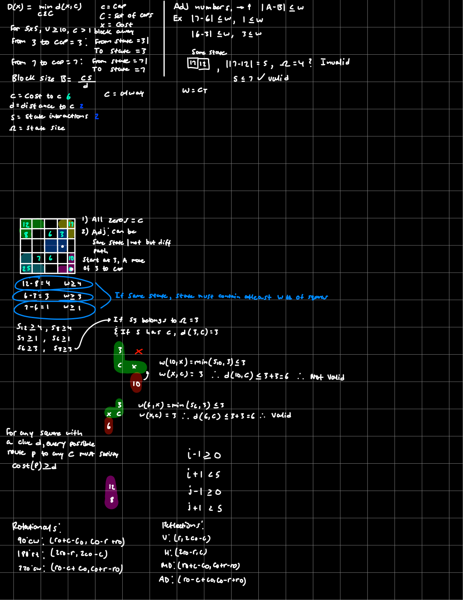
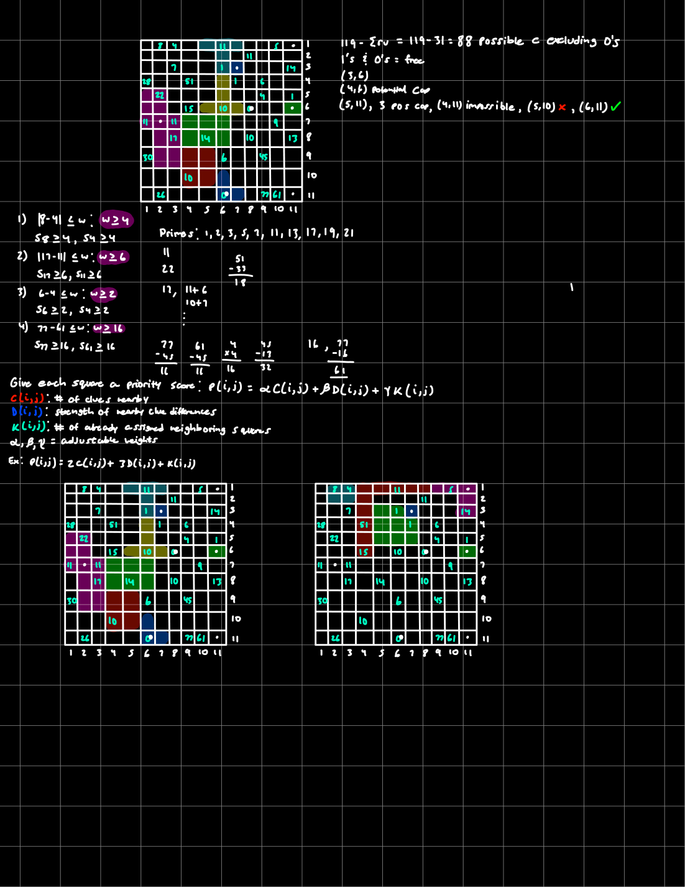
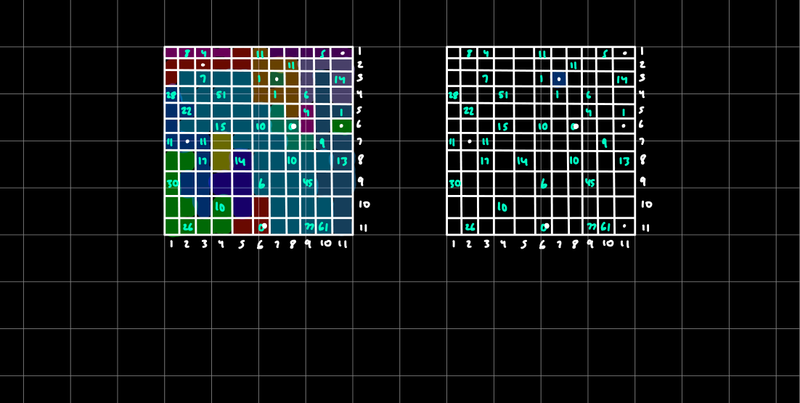
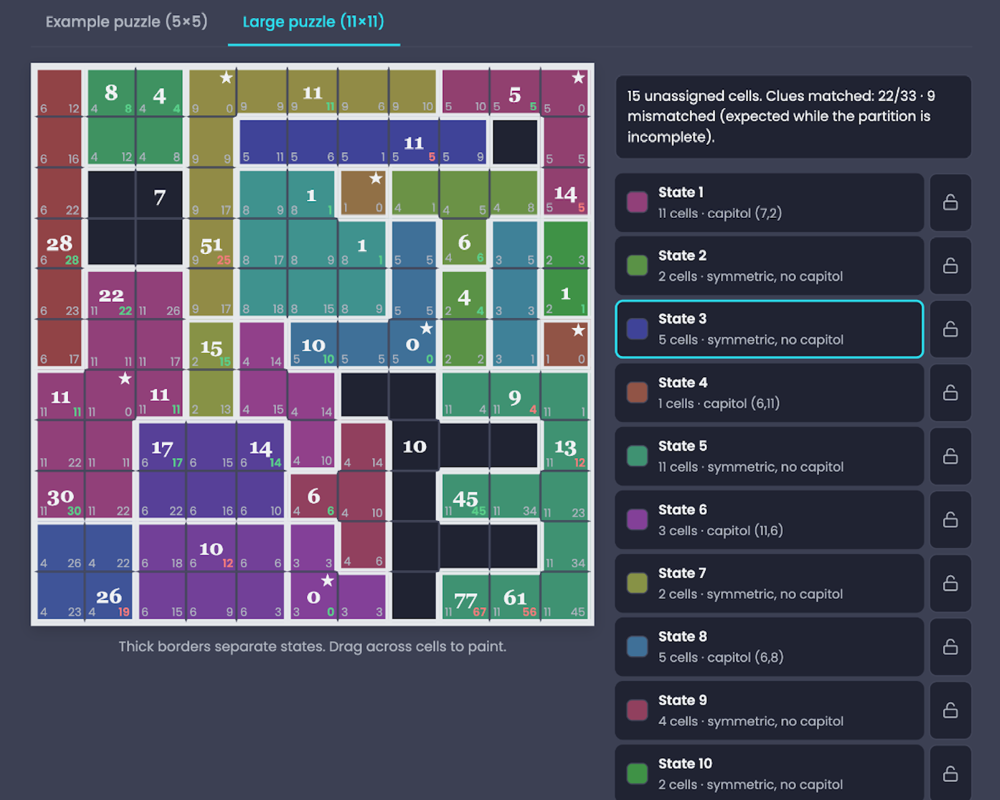

# It's a Metric, Too.

### Eight days of symmetry, shortest paths, and a lot of trial and error.

*My experience working through Jane Street's 11 × 11 puzzle going from iPad sketches to an interactive board.*

[The puzzle](#the-puzzle) · [My notes](#my-handwritten-notes) · [Interactive board](#interactive-exploration) · [What I learned](#looking-back) · [Credits](#links-and-credits)

---

## The puzzle

I spent eight days trying to make sense of Jane Street's **It's a Metric, Too** puzzle. At first, I figured I'd be able to work through it by identifying a few symmetric regions and building from there. It turned out to be a lot more complicated than that.

The challenge is an **11 × 11 grid** divided into connected, symmetric regions called *states*. The numbers aren't state sizes: each one represents the minimum cost of traveling from that square to a state capital. What makes the puzzle interesting is that changing even one state can change the travel costs across the board.

  

<em>The original 11 × 11 puzzle. Source: Jane Street.</em>

### The rules, in brief

1. Every square belongs to one **state**, and each state must be connected through horizontal or vertical neighbors.
2. Each state must have at least one nontrivial **symmetry**, such as a rotation or reflection.
3. Some states have a **capital**, located at a square fixed by every symmetry of that state. Not every state has one.
4. Moving between adjacent squares **inside the same state** costs the number of squares in that state.
5. Moving between **different states** costs the size of the smaller state.
6. Each numbered square gives the **minimum total travel cost** to any capital.

After satisfying all the clues, the answer is calculated by writing each state's size in its squares, adding those values across each row, squaring the row sums, and adding the squares together.

### The 5 × 5 example

Before tackling the full puzzle, I spent time understanding the smaller example. Seeing the completed states, their capitals, and the state size grid side by side helped me understand what the numbers were actually measuring.

The example's answer is **8,045**. I kept coming back to it whenever I needed to check whether I was interpreting a rule correctly.

---

## How I approached it

I started with handwritten diagrams on my iPad. I tried placing small symmetric states, checking where capitals could go, and comparing the numbered clues with the cost of moving between squares. Sometimes an arrangement seemed to work for one part of the grid, only to cause problems somewhere else.

As I worked through it, I began writing down more general relationships instead of just drawing possible shapes. In particular, I was interested in what neighboring clues could tell me about the minimum size of the states around them.

For two adjacent numbered squares, the difference between their distances to a capital cannot be greater than the cost of crossing the edge between them:

For example, the adjacent **77** and **61** clues differ by **16**, so the cost of moving directly between those squares must be at least 16. That doesn't solve the region by itself, but it immediately rules out some smaller-state arrangements.

I also experimented with coordinate formulas for rotations and reflections, along with ways of representing the board as a weighted graph. A lot of these notes are rough, but that's part of why I wanted to keep them.

---

## My handwritten notes

These are the actual pages I worked on. They're not meant to be a polished proof or a step-by-step solution; they're a record of the ideas I was testing, including ones that didn't pan out.

### 01 — Getting familiar with the rules

My first page was mostly about translating the puzzle into something I could reason about: what made a valid state, how travel costs work, and how the 5 × 5 example is scored. I also started sketching possible state patterns on the larger grid.

### 02 — Turning observations into constraints

On the next page, I started treating the clue values as shortest-path distances. I wrote down inequalities for neighboring squares and tested how the cost of crossing a state boundary affects which paths are possible. I also collected the coordinate transformations for rotations and reflections, since checking symmetry by eye was getting difficult.

### 03 — Applying the ideas to the 11 × 11 grid

This is where I began using the larger clues to narrow down possibilities. I looked at differences between nearby numbers, including the **77** and **61** pair, and tried assigning priorities to squares based on the clues and neighboring regions. I kept testing colored configurations to see which deductions could coexist.

### 04 — More configurations, more revisions

By this point, I had several different versions of the grid. Some regions looked promising, but the overall arrangement still wasn't consistent. I kept a few of these attempts because they show how much of the process was revisiting assumptions rather than making one clean sequence of deductions.

<strong>View the original four-page notebook PDF</strong>

[Open my original iPad notes (PDF)](notes/Puzzles-original.pdf)

---

## Interactive exploration

After spending so much time sketching different arrangements on my iPad, I came across an [interactive version of the puzzle](https://pazqo.github.io/#/games/nation-puzzle). This was easily the most useful thing I found during the entire process.

The biggest problem with doing everything by hand was that I could spend a while drawing a state, checking its symmetry, and calculating a few distances, only to realize that something elsewhere on the board no longer worked. Then I'd have to redraw everything. On the interactive board, I could move boundaries around, see the size of each state, and immediately check how many of the numbered clues matched. It didn't do the reasoning for me, but it made testing my reasoning *so* much easier.

### One of the initial close attempts

At one point, I had **15 unassigned cells** remaining and **22 of the 33 clues matching**. I was starting to feel like I was getting somewhere. Some of the regions looked convincing, and a few of my assumptions about where capitals might belong seemed to be holding up.
This image was from day 4 of attempting to solve the puzzle so there was still more work to go as it looked like many of the states were somewhat close but also not quite.

<em>One of my intermediate configurations: 22/33 clues matched, but the partition still wasn't complete.</em>

The frustrating part was that fixing one mismatch could create another. I could get a section of the grid to behave correctly and still be completely wrong about the overall state structure. Looking back, this was probably the clearest example of how interconnected the puzzle really was.

### Seeing the completed grid

Eventually, I finally had worked through the entirety of the board, doing various guesses and checks while sticking to the rules of the puzzle.
One of the biggest realizations I had mid way through the puzzle was that my original 11 state configuration felt right in terms of size due to the squares with values 11 and 22, but it felt as if the shape of it was incorrect. As i continued to work through it I later reconfigured it to allow for the bottom left corner of the board to have a size of 10 which meshed perfectly with the state of size 11, and the capital at (11,6).

<strong>Reveal the completed 11 × 11 grid (spoiler)</strong>

<em>The completed configuration shown on the interactive board.</em>

As I was messing around with various combinations, one of the things that stood out to me was the large numbers of 45, 77, 61, and 51. Now to begin I never initially though that this would all be one huge state, so as I was going along and started to see that this could be a possibility i was kind of in shock that the state was going to potentially be that large. A couple of ideas I had was that the bottom right was just going to be one big state but never really thought that this single state would all connect and be roughly 40 squares for a single state. Oddly enough this happened to be the last state i pieced together and as you could possibly imagine it took quite a while as I initially thought something must be wrong especially as i would connect certain squares and was still trying to mesh other squares together which never worked.

### Credit where it's due — Stefano Pascolutti

A huge shout-out to **[Stefano Pascolutti](https://www.linkedin.com/in/pazqo/)** for creating the [interactive Nation Puzzle board](https://pazqo.github.io/#/games/nation-puzzle). I genuinely don't think my experience with this puzzle would have been the same without it.

Before finding the board, I was drawing and redrawing states on my iPad, trying to keep track of their sizes, capitals, and travel costs. That was useful for understanding the rules, but it became pretty difficult to manage as the grid got more complicated. Stefano's tool gave me a way to actually *experiment*: change a boundary, see the new state sizes, and check how many clues still matched.

What I appreciated most was that it wasn't simply an answer generator. I still had to decide which shapes were worth trying and work out why an arrangement might make sense. The board just made it much easier to see when I was wrong and move on to another idea. It helped me make far more progress than I could have by repeatedly starting over on paper.

I'm really grateful that he made this available. It's a great example of how a relatively simple interactive interface can make a difficult mathematical problem much more approachable.

**Links:** [Stefano on LinkedIn](https://www.linkedin.com/in/pazqo/) · [Try the interactive puzzle board](https://pazqo.github.io/#/games/nation-puzzle)

### Something I'd like to explore myself

One thing I took away from this experience is how useful a small, purpose-built interactive tool can be for a difficult puzzle. There's a big difference between staring at a static grid and being able to change a hypothesis, see its consequences, and immediately test another one.

It also got me thinking about making something similar for future puzzles. Not necessarily a program that automatically solves everything, but a tool that helps with the **exploration**: drawing candidate regions, checking rules, highlighting contradictions, and tracking progress.

I'd love to try building a reusable version of this idea someday. I can imagine starting with a grid editor and a few rule-checking functions, then gradually adding features like undo/redo, live constraint validation, and a way to save different attempts. For a puzzle like this one, even something as simple as displaying which clues are satisfied and which are not makes a huge difference.

The interesting part to me is that the software wouldn't replace the reasoning. It would give me a better environment to *do* the reasoning. After spending eight days on this puzzle, that's an idea I'm definitely interested in exploring further.

---

## Looking back

One thing this puzzle really drove home for me was how much harder a problem becomes when every local decision affects the rest of the system. I could make progress in one corner, but that didn't mean the full configuration would work.

I also tried approaching parts of it computationally. The smaller **5 × 5** example was manageable, but scaling the search to the **11 × 11** puzzle was a different challenge altogether. Generating more candidate states wasn't enough when the search could still miss an important shape.

During the solve of this puzzle I also started working on some code that would in theory make this puzzle way easier to solve. Ill say I'm nowhere near the best programmer, even horrible in some regards, but I ran into issues even with just trying to get my code to solve an empty 5x5 slate. When I ran into this issue i figured the 11x11 would probably be computationally impossible to solve for the code I had.

<strong>Final score (spoiler)</strong>

The completed configuration gives a score of **408,951**. The most surprising feature is the irregular **37-cell state**, which has 180° rotational symmetry.

## Final thoughts

Eight days, a lot of sketches, plenty of wrong turns, and a much better appreciation for geometry. I wanted to share the process rather than just post the answer, because the attempts that didn't work were a big part of what made this interesting. I also wanted to say if there are any easier ways to solve this puzzle that I maybe didn't catch such as tricks that I missed or a solid algorithm that can solve this puzzle way better computationally I would greatly appreciate the feedback as I essentially brute forced this puzzle while following what I believe are basic principals and understandings of the puzzle.

---

## Links and credits

- **Original puzzle:** Jane Street, [*It's a Metric, Too*](https://www.janestreet.com/puzzles/).
- **Interactive board:** [Nation Puzzle](https://pazqo.github.io/#/games/nation-puzzle), created by **[Stefano Pascolutti](https://www.linkedin.com/in/pazqo/)**. His tool made exploring and testing configurations much easier.
- **Notebook pages:** My original handwritten iPad notes, included above and in [PDF form](notes/Puzzles-original.pdf).

*This is a personal project journal, not an official Jane Street solution or affiliated project.*
